<!-- Generated from data/*.yaml by tools/generate_github_profile.py in the portfolio repository. Do not edit here. -->

<picture><source media="(prefers-color-scheme: dark)" srcset="assets/banner-dark.svg"></picture>

Senior software engineer & software architect with background in physics and a PhD in computer science. I solve problems.

<picture><source media="(prefers-color-scheme: dark)" srcset="assets/tech-dark.svg">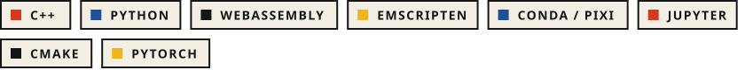</picture>

  <a href="https://www.linkedin.com/in/thorsten-beier-95b121189/"><picture><source media="(prefers-color-scheme: dark)" srcset="assets/link-0-dark.svg"></picture></a>
  <a href="https://scholar.google.com/citations?user=zoHhaQ4AAAAJ"><picture><source media="(prefers-color-scheme: dark)" srcset="assets/link-1-dark.svg"></picture></a>
  <a href="https://emscripten-forge.org"><picture><source media="(prefers-color-scheme: dark)" srcset="assets/link-2-dark.svg"></picture></a>

<picture><source media="(prefers-color-scheme: dark)" srcset="assets/band-dark.svg"></picture>

### Pinned work

  <a href="https://github.com/emscripten-forge/recipes"><picture><source media="(prefers-color-scheme: dark)" srcset="assets/pin-0-dark.svg">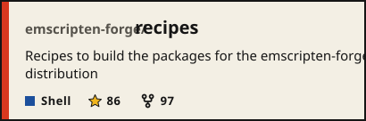</picture></a>
  <a href="https://github.com/emscripten-forge/pyjs"><picture><source media="(prefers-color-scheme: dark)" srcset="assets/pin-1-dark.svg">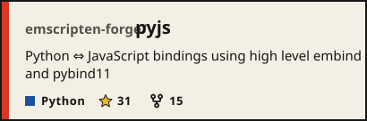</picture></a>
  <a href="https://github.com/jupyterlite/xeus"><picture><source media="(prefers-color-scheme: dark)" srcset="assets/pin-2-dark.svg">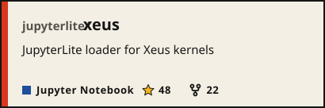</picture></a>
  <a href="https://github.com/jupyterlite/jupyterlite"><picture><source media="(prefers-color-scheme: dark)" srcset="assets/pin-3-dark.svg">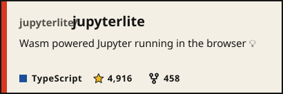</picture></a>
  <a href="https://github.com/jupyter-xeus/xeus-python"><picture><source media="(prefers-color-scheme: dark)" srcset="assets/pin-4-dark.svg">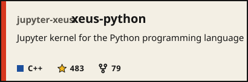</picture></a>
  <a href="https://github.com/jupyter-xeus/xeus"><picture><source media="(prefers-color-scheme: dark)" srcset="assets/pin-5-dark.svg">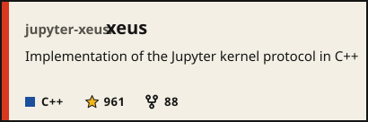</picture></a>

<picture><source media="(prefers-color-scheme: dark)" srcset="assets/band-dark.svg"></picture>

### Career

<picture><source media="(prefers-color-scheme: dark)" srcset="assets/career-dark.svg"></picture>

<picture><source media="(prefers-color-scheme: dark)" srcset="assets/band-dark.svg"></picture>

### On GitHub

<picture><source media="(prefers-color-scheme: dark)" srcset="assets/stats-dark.svg">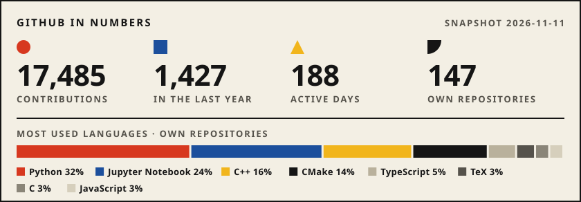</picture>

<picture><source media="(prefers-color-scheme: dark)" srcset="assets/calendar-dark.svg"></picture>

<picture><source media="(prefers-color-scheme: dark)" srcset="assets/years-dark.svg"></picture>

<picture><source media="(prefers-color-scheme: dark)" srcset="assets/band-dark.svg"></picture>

Numbers as of 2026-11-11. Drawn in the design of my website.
